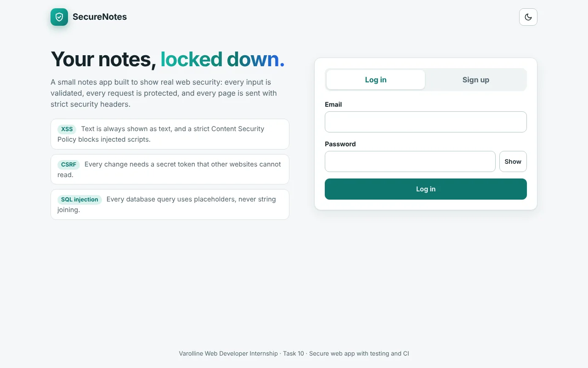
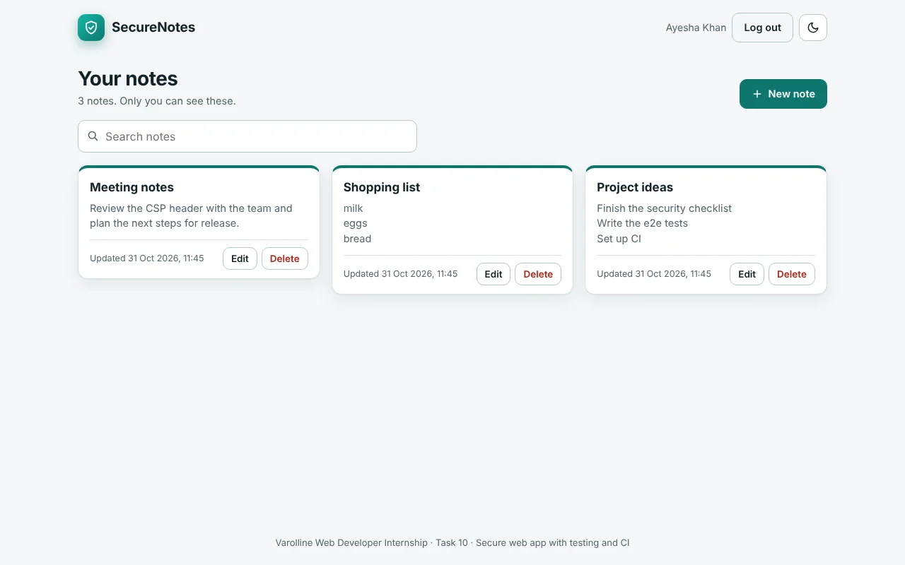
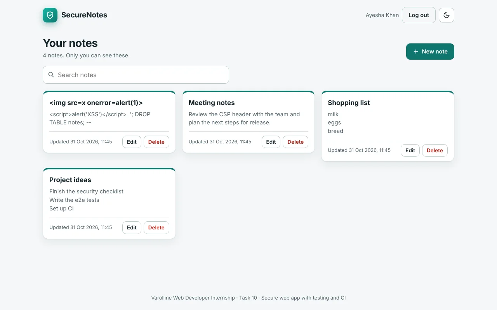
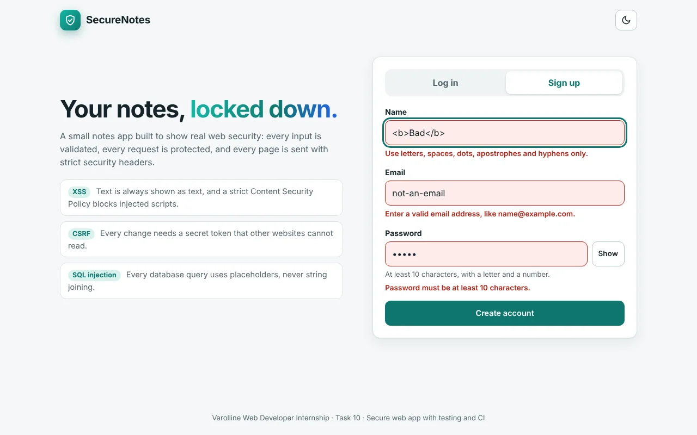
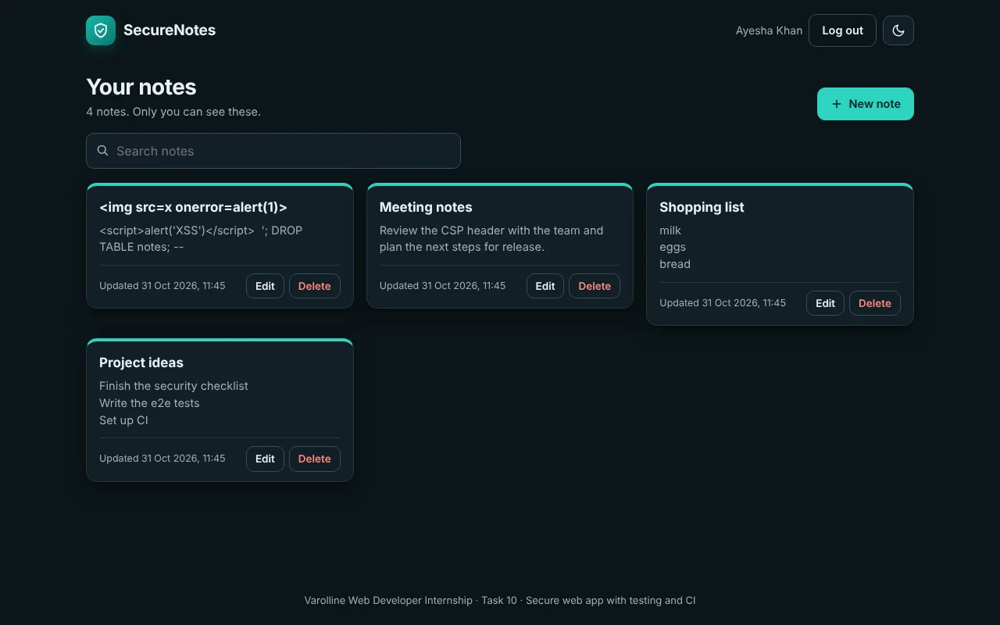
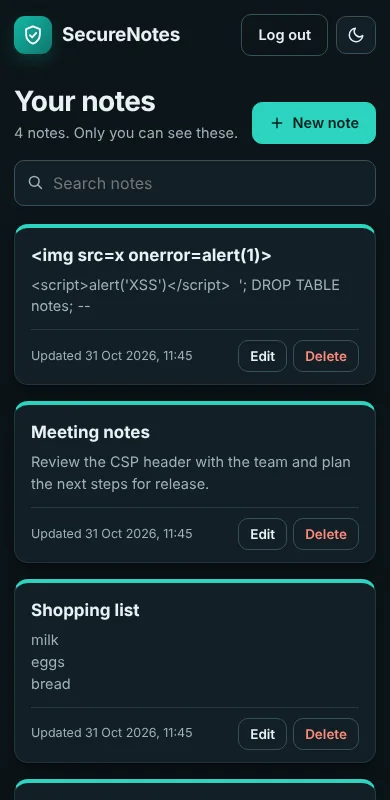

# SecureNotes: a secure web app with testing and CI

A small private notes app, built to show how to protect a web app against **XSS, CSRF and SQL injection**, with input validation on both client and server, secure headers, **57 unit/API tests**, **7 end-to-end tests** (Playwright) and a **GitHub Actions CI workflow** that runs them.
Built for the Varolline Web Developer internship (Task 10).

**Author:** Mahin Saleem  
**Repository:** https://github.com/mahinsaleem001-debug/Web_Developer_Varolline_Task10



## What it does

- Sign up, log in and log out (server-side sessions)
- Create, edit, delete and search **your own** private notes. Nobody else can see them.
- Works in light and dark mode, on desktop and phone, and with a keyboard and screen reader

| Requirement | Where to look |
|---|---|
| Authentication | `server/app.js` (sign-up, login, logout, sessions) |
| Protection against XSS, CSRF, SQL injection | [`SECURITY.md`](SECURITY.md): the full checklist, risk by risk, with code locations and the test that proves each one |
| Input validation, client **and** server | `public/js/validate.js` (one set of rules used by both) |
| Secure headers | `server/app.js` (CSP, nosniff, frame, referrer, permissions, HSTS...) |
| Unit tests | `tests/unit/` (57 tests) |
| At least 3 end-to-end tests | `tests/e2e/securenotes.spec.js` (7 tests, Playwright) |
| CI workflow | `.github/workflows/ci.yml` |
| Security checklist | [`SECURITY.md`](SECURITY.md) |

## Run it

You need **Node.js 22.13 or newer** (check with `node -v`). The database (`node:sqlite`) is built into Node, so there is nothing native to compile. Node prints one "ExperimentalWarning: SQLite" line at start-up; that is normal.

```bash
npm install
npm start
```

Open http://localhost:3000, click **Sign up**, and create an account.

> On Windows PowerShell, if `npm` is blocked, use `npm.cmd install` and `npm.cmd start`.

Configuration is by environment variables (copy `.env.example` to `.env` or set them in your host):

| Variable | Default | Meaning |
|---|---|---|
| `PORT` | `3000` | Port to listen on |
| `DB_FILE` | `data/securenotes.db` | SQLite database file (created automatically) |
| `NODE_ENV` | | Set to `production` when deployed: cookies become `Secure`, HSTS is sent |
| `TRUST_PROXY` | | Set to `1` when running behind a proxy such as Render or Nginx |
| `BCRYPT_COST` | `12` | Password hashing cost |

## Tests

```bash
npm test                 # 57 unit and API tests (fast, about 5 seconds)
npx playwright install chromium     # one time: downloads the test browser
npm run test:e2e         # 7 end-to-end tests in a real browser
npm run audit            # checks dependencies for known vulnerabilities
```

**What the tests cover**

| Suite | Tests | What it proves |
|---|---|---|
| `tests/unit/validate.test.js` | 12 | Every validation rule, including wrong types and attack strings |
| `tests/unit/security.test.js` | 5 | Cookie parsing, origin check, constant-time compare, rate limiter |
| `tests/unit/db.test.js` | 9 | SQL injection payloads are harmless, users only reach their own rows, database rules |
| `tests/unit/api.test.js` | 31 | Login, sessions, CSRF, rate limits, access control, security headers, errors |
| `tests/e2e/securenotes.spec.js` | 7 | Real browser: the full user flow, XSS, CSRF from an "evil website", SQL injection, client and server validation, headers and cookies, two users |

The end-to-end tests start the real server with a throw-away in-memory database, so they never touch your data.

### Continuous integration

`.github/workflows/ci.yml` runs on every push to `main` and every pull request:

1. **Unit and API tests**
2. **Dependency audit** (`npm audit`, fails on high or critical issues)
3. **End-to-end tests** with Playwright (installs Chromium, saves a report if something fails)

A red cross on a commit means a test failed. Open the **Actions** tab on GitHub to see which one.

## API

All routes are JSON. Changing requests need the headers `X-Requested-With: securenotes` and (when logged in) `X-CSRF-Token`, which the app handles for you.

| Method and path | Needs login | What it does |
|---|---|---|
| `GET /api/session` | no | Who am I? Returns the user and the CSRF token |
| `POST /api/signup` | no | Create an account and log in |
| `POST /api/login` | no | Log in |
| `POST /api/logout` | yes | End the session |
| `GET /api/notes?q=word` | yes | List your notes, optionally searching |
| `POST /api/notes` | yes | Create a note `{ title, body }` |
| `PUT /api/notes/:id` | yes | Edit one of your notes |
| `DELETE /api/notes/:id` | yes | Delete one of your notes |

Errors look like `{ "error": { "code": "VALIDATION", "message": "...", "fields": { "email": "..." } } }` and use clear status codes: 400 validation, 401 not logged in, 403 blocked (CSRF), 404 not found, 409 conflict, 413 too large, 415 wrong content type, 429 too many attempts.

## Project structure

```
server/
  index.js        Starts the server
  app.js          Express app: headers, CSRF, sessions, routes, error handling
  db.js           All SQL (prepared statements only)
  security.js     Cookie parsing, constant-time compare, origin check, rate limiter
public/
  index.html      Page (no inline scripts or styles: the CSP forbids them)
  css/style.css   Design, light and dark theme
  js/validate.js  Validation rules shared by browser and server
  js/api.js       API client (adds the CSRF protection headers)
  js/app.js       UI (text is only ever set with textContent)
tests/unit/       Unit and API tests (node:test)
tests/e2e/        End-to-end tests (Playwright)
.github/workflows/ci.yml   CI workflow
SECURITY.md       Security checklist
```

## Screenshots

| Notes | HTML shown as plain text (XSS blocked) | Validation errors |
|---|---|---|
|  |  |  |

| Dark mode | Mobile |
|---|---|
|  |  |

## Deploying

The app serves HTTPS only through your host. On Render, Fly or similar: set `NODE_ENV=production`, `TRUST_PROXY=1`, and point `DB_FILE` at a persistent disk. See the "Known limits" section of [`SECURITY.md`](SECURITY.md).

## Tech

Node.js · Express · SQLite (built-in node:sqlite) · bcryptjs · helmet · vanilla JavaScript, HTML and CSS · node:test · Playwright · GitHub Actions

## AI tool usage

Built with assistance from an AI tool (Claude). I reviewed, ran and tested the code, checked that the tests fail when a protection is removed, and can explain each part.
